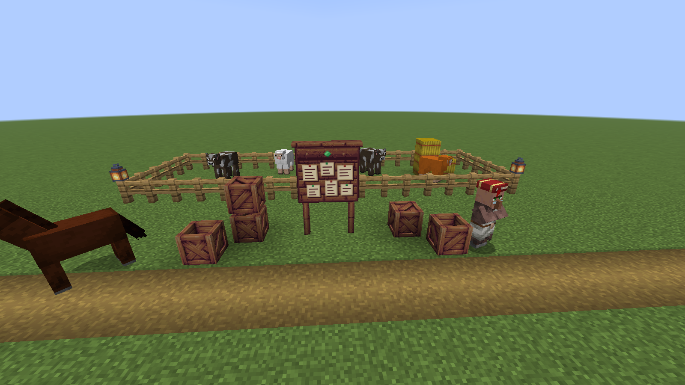
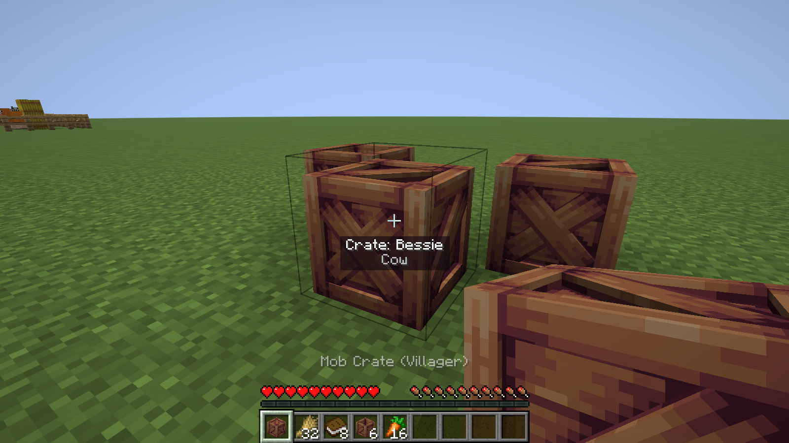
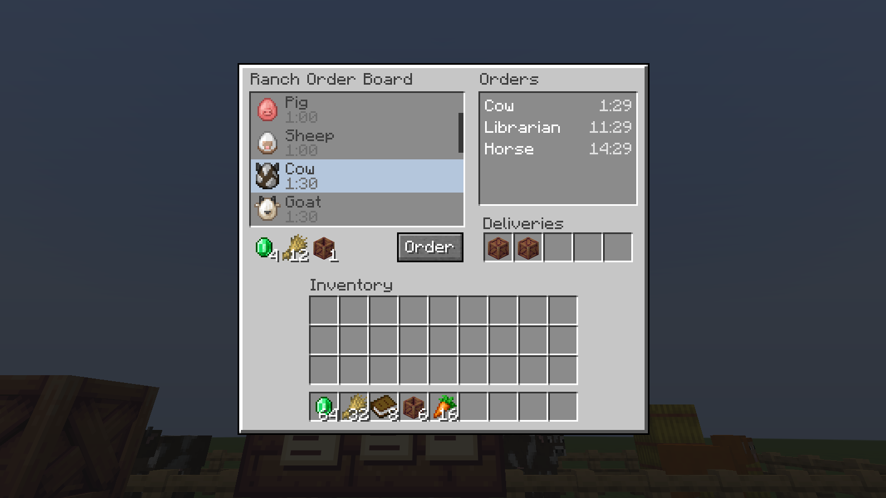
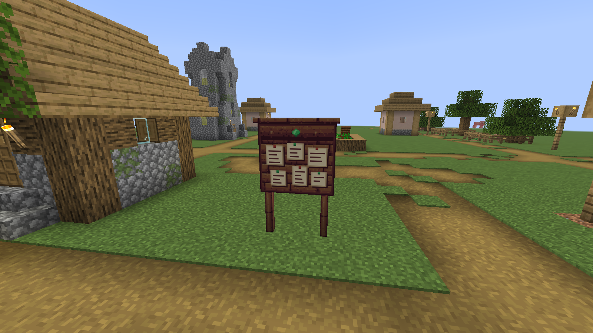

<div align="center">

# Mob's On Demand

**Pack up, move and order passive mobs, delivered in crates.**

[](https://www.minecraft.net)
[](https://fabricmc.net)
[](https://adoptium.net)
[](LICENSE.txt)



</div>

Getting a librarian to your trading hall or a pair of cows to your new base usually means leads, boats and minecart tracks. **Mob's On Demand** gives you two simpler options:

- **Mob Crates**: pack a mob into a crate, carry it anywhere, unpack it.
- **Ranch Order Boards**: order animals and villagers for emeralds and feed, and they're delivered to you in crates.

## Features

### 📦 Mob Crates

| | |
|---|---|
|  | **Capture**: right-click a passive mob with an empty crate. Everything is kept: name, variant, age, health, and a villager's profession, level and trades.<br><br>**Release**: right-click a block. The mob steps out with a fresh UUID and won't despawn.<br><br>**Place**: an empty crate places like a block; sneak to place a full one. Break it with an axe to get it back, mob and all.<br><br>**Inspect**: sneak and look at a placed crate to see what's inside. |

- Villagers give up their bed, workstation and bell when crated, so others can claim them.
- Leads drop and riders dismount.
- You can't crate someone else's pet, a mob that's sleeping or trading, or a mob inside a protected claim.

### 📋 Ranch Order Board



A 2×3 notice board that works as a livestock delivery service.

1. Pick an animal from the shop. The cost appears underneath, and anything you're missing is tinted red.
2. Press **Order**. Payment is taken from your inventory, along with one empty Mob Crate for the delivery.
3. Up to 5 orders queue up and arrive one after another, **even while the area is unloaded**.
4. Delivered crates appear in the **Deliveries** slots. Hoppers can pull them out.

Breaking the board drops any delivered crates and refunds every order still waiting.

### 🏘️ Found in villages



Order boards generate along the streets of plains, desert, savanna, snowy and taiga villages, so you can shop for livestock before you can craft a board yourself. How many generate, and in which villages, is configurable.

## Crafting

**Mob Crate**

| | | |
|:---:|:---:|:---:|
| Iron Ingot | Lead | Iron Ingot |
| Planks | | Planks |
| Planks | Planks | Planks |

**Ranch Order Board**

| | | |
|:---:|:---:|:---:|
| Planks | Emerald | Planks |
| Planks | Book | Planks |
| Planks | Planks | Planks |

Any wood planks work.

## Configuration

`config/mobs_on_demand.json` is created on first launch and reloads with `/reload`.

| Option | Default | Description |
|---|---|---|
| `allowBabies` | `true` | Allow crating baby animals and villagers. |
| `ordersRequireCrate` | `true` | Each order also consumes one empty Mob Crate. |
| `villageSignsPerVillage` | `1` | Most order boards one village can generate with. `0` turns them off. |
| `villageSignChancePercent` | `10.0` | Chance for each village house spot to become a board (until the cap is reached). |
| `villageBlacklist` | `[]` | Village types without boards: `"desert"`, `"minecraft:village_snowy"` or `"minecraft:village/taiga/houses"`. |
| `ftbAllowAllies` | `true` | With FTB Chunks, allied teams may crate mobs in your claims. |

The village settings apply when a world starts and only affect newly generated chunks.

## Data packs

Everything you buy is data-driven, and `/reload` applies changes immediately.

### Shop offers

Each offer is one file: `data/<namespace>/mobs_on_demand/shop/<name>.json`

```json
{
  "sort": 50,
  "entity": "minecraft:cow",
  "cost": [
    { "ingredient": "minecraft:emerald", "count": 4 },
    { "ingredient": "#minecraft:wool", "count": 2 }
  ],
  "delivery_seconds": 90
}
```

| Field | Required | Description |
|---|:---:|---|
| `entity` | ✅ | Mob to deliver. Any entity type, including modded ones. |
| `cost` | ✅ | Items taken from the player. `ingredient` is an item or a `#tag`; `count` defaults to 1. |
| `delivery_seconds` | ✅ | Time until the crate arrives. |
| `sort` | | Position in the shop, lowest first (defaults use 10–130). Ties are ordered by ID. |
| `name` | | Text component shown in the shop, e.g. `{ "translate": "entity.minecraft.villager.librarian" }`. |
| `icon` | | Item shown as the icon. Defaults to the mob's spawn egg. |
| `entity_data` | | NBT applied to the delivered mob, e.g. `{ "VillagerData": { "profession": "minecraft:librarian" }, "Xp": 1 }`. |
| `enabled` | | `false` hides the offer. |

**Change or remove a default offer** by adding a file with the same path, e.g. `data/mobs_on_demand/mobs_on_demand/shop/cow.json`, and setting new values or `"enabled": false`.
**Add an offer** under your own namespace, e.g. `data/mypack/mobs_on_demand/shop/fox.json`.

<details>
<summary>Default shop</summary>

| Offer | Cost | Delivery |
|---|---|---|
| Chicken | 1 emerald, 8 wheat seeds | 0:30 |
| Rabbit | 2 emeralds, 4 carrots | 0:45 |
| Pig | 3 emeralds, 8 carrots | 1:00 |
| Sheep | 3 emeralds, 8 wheat | 1:00 |
| Cow | 4 emeralds, 12 wheat | 1:30 |
| Goat | 4 emeralds, 8 wheat | 1:30 |
| Cat | 4 emeralds, 4 cod | 1:00 |
| Wolf | 6 emeralds, 4 bones | 1:30 |
| Donkey | 6 emeralds, 2 hay bales | 2:30 |
| Horse | 8 emeralds, 2 golden carrots | 3:00 |
| Villager | 12 emeralds, 8 bread | 5:00 |
| Farmer | 16 emeralds, 2 hay bales | 7:30 |
| Librarian | 24 emeralds, 4 books | 10:00 |

Delivered farmers and librarians keep their profession even before they get a workstation.

</details>

### Capturable mobs

The entity type tag `#mobs_on_demand:capturable` decides what fits in a crate. By default it holds 32 passive mobs, including farm animals, horses, pets, villagers, sniffers, happy ghasts and copper golems. Hostile mobs, iron golems and wandering traders are left out. Extend it from a data pack with `data/mobs_on_demand/tags/entity_type/capturable.json`:

```json
{ "values": ["minecraft:iron_golem"] }
```

## Compatibility

- **FTB Chunks**: crating and releasing respect claims (team members, plus allies if enabled). The integration turns on automatically once FTB Chunks is available for this Minecraft version.

## Building

No Java install needed: Gradle downloads Java 25 automatically.

```sh
./gradlew build              # jar in build/libs
./gradlew runClient          # dev client
./gradlew runClientGameTest  # re-render the README screenshots into docs/images
```

## License

Copyright © 2024–2026 Bandit-Bytes. **All Rights Reserved.** See [LICENSE.txt](LICENSE.txt).
